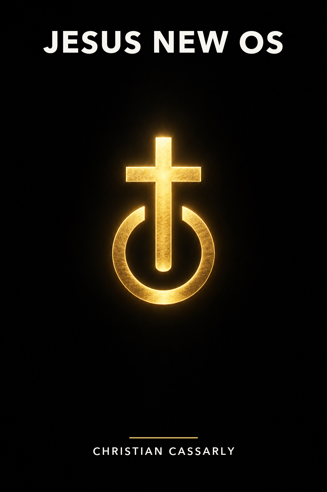

# Jesus New OS: Christ Mind OS

By **Christian Cassarly**.

Read the complete revised book free:

- [Download the PDF](Jesus-New-OS-Christ-Mind-OS.pdf) — 206 pages, clickable chapter contents, and bookmarks.
- [Download the EPUB](Jesus-New-OS-Christ-Mind-OS.epub) — repaired navigation and embedded cover.
- [Read free on Google Play Books](https://play.google.com/store/books/details?id=gygQEgAAQBAJ).
- [Read or download on Internet Archive](https://archive.org/details/jesus-new-os-christ-mind-os-polished-2026).

Jesus New OS: Christ Mind OS brings together three earlier works into one continuous literary and spiritual reading experience, spanning Christian Cassarly’s New York years through the present. This personal book connects faith, purpose, and transformation through the language of an operating system.

Explore the author’s technology and wider project at [JesusNew.com](https://jesusnew.com).

## Edition and rights

This repository distributes the author-approved revised digital edition prepared in October 2026. Files are offered free for reading. Copyright and ownership remain with Christian Cassarly; all rights reserved. Free access does not place the work in the public domain or grant an open-source license.

## Navigation

The PDF includes 57 internal contents links and 78 bookmarks. The EPUB navigation was validated with EPUBCheck 5.4, with zero errors or warnings.
